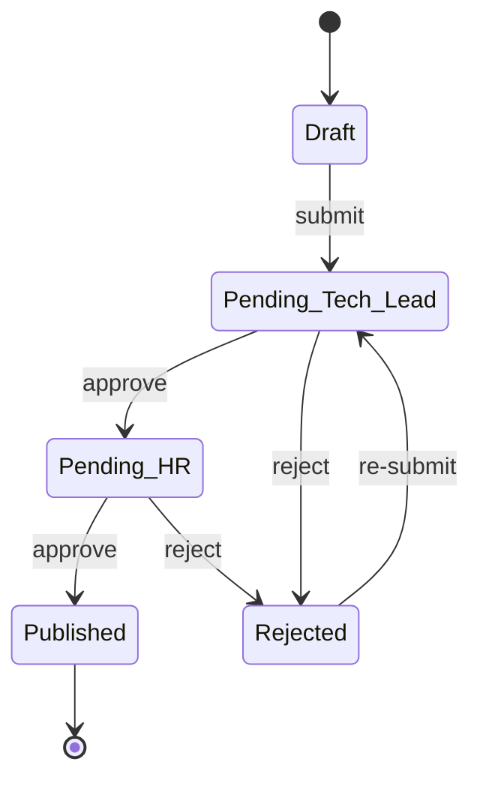
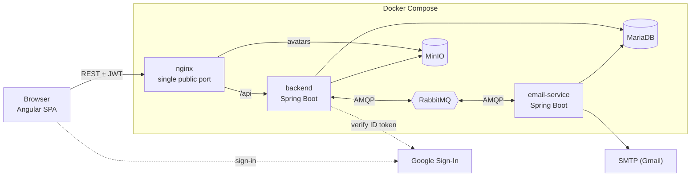

# CV Management

An internal web application for managing employee CVs in a software company. Employees keep their CVs up to date, Tech Leads and HR review every change before it goes live, and HR can ask people to update their CVs, with reminders sent automatically until they do.

The system is built for a company of about 50 people. It favours simple, auditable workflows over infrastructure built for scale.

> The user interface is in Vietnamese. CV content can be written in Vietnamese, English and Japanese.

## Features

- **Versioned CVs.** A published CV is never overwritten. Every accepted change creates a new, immutable version (v1 → v2 → …) that stores a full snapshot of the content. You can browse the history, compare any two versions side by side, and roll back. A rollback publishes a new version and keeps everything in between.
- **Profiles × languages.** One employee can have several *profiles* (professional personas, such as "Software Developer" and "AI Engineer"), each with CVs in `vi`, `en` and `ja`. Within a profile, the first CV is the master. Adding, removing or reordering sections in the master propagates to the other languages as untranslated placeholders.
- **Two-level approval.** An employee's edits go into a draft that a Tech Lead approves for technical content (level 1) and then HR approves for format and spelling (level 2). Each pending draft is assigned to exactly one reviewer per level. Reviewers can reject with inline comments anchored to specific sections, and the employee can reply. Each assignment has an SLA (3 days by default).
- **Update requests.** HR asks employees to update a CV, one at a time or in batches, with a deadline. A background worker sends batch notifications and reports progress. A daily job reminds employees as the deadline approaches and sends Admin and HR one digest of overdue reviews.
- **Role-based data scope.** Each role sees only the data it is allowed to. The backend applies this in the database query, not in the UI.
- **Organisation structure.** Departments form a tree. Teams (projects) are separate, can draw members from any department, and each has a Tech Lead.
- **Self-service profile updates.** Users propose changes to their own personal details, and Admin or HR approves them.
- **Also included:** full-text CV search, PDF export (with embedded Vietnamese and Japanese fonts), soft delete and restore, in-app and email notifications, an audit log, a dashboard, and configurable reminder and SLA settings.

### Roles

| Role | Can see and do |
|---|---|
| **Admin** | Everything. Manages users, departments and teams. The only role that can reassign reviews, cancel a draft under review, change roles, deactivate accounts or reset passwords. |
| **HR** | All CVs company-wide. Creates update requests and gives level-2 (format) approval. Manages Employee and Tech Lead accounts, but not roles, account status or passwords. |
| **Tech Lead** | CVs of members of the teams they lead. Gives level-1 (technical) approval. |
| **Employee** | Their own CVs and the update requests addressed to them. |

### Approval flow



A re-submitted draft always starts again at the Tech Lead step. Admin and HR users editing their **own** CV publish directly, without approval.

## Architecture



- **nginx is the only exposed port.** It serves the SPA and proxies `/api` to the backend and avatar images to MinIO, so everything shares one origin and no CORS is needed.
- **The backend** is a layered Spring Boot monolith: REST API, security, business rules, Flyway migrations at startup, and the daily reminder job.
- **Email is asynchronous.** The backend publishes messages to RabbitMQ, and `email-service` renders the Thymeleaf templates and sends them over SMTP, retrying on failure. No request waits on SMTP, and every email also has an in-app notification.
- **Images are never stored in CV content.** Avatars live in MinIO, and the browser loads them through short-lived presigned URLs.
- **Google Sign-In never creates accounts.** It matches the Google email against an existing account. Roles always come from the application's own database.

### Tech stack

| Layer | Technology |
|---|---|
| Frontend | Angular 22 (standalone components, signals, lazy routes), Angular Material + CDK, RxJS |
| Backend | Spring Boot 3.3, Java 17, Spring Security (stateless JWT via jjwt), Spring Data JPA, Flyway, springdoc-openapi |
| Email worker | Spring Boot, Spring AMQP, JavaMail, Thymeleaf |
| Database | MariaDB 11.4: CV content stored as JSON, FULLTEXT search index |
| File storage | MinIO (S3-compatible) |
| Messaging | RabbitMQ 3.13 |
| Other libraries | java-diff-utils (version diff), openhtmltopdf (PDF export), MinIO SDK, Google API Client |
| Testing | JUnit 5 + Testcontainers (backend), Vitest (frontend) |
| Packaging | Docker and Docker Compose |

## Repository layout

```
.
├── backend/                 Spring Boot REST API
│   └── src/main/resources/
│       ├── db/migration/    Flyway migrations (run automatically at startup)
│       ├── templates/       Thymeleaf templates for PDF export
│       └── fonts/           Fonts embedded in exported PDFs
├── email-service/           RabbitMQ consumer that renders and sends emails
├── frontend/                Angular SPA, plus nginx config for the production image
├── docker/minio-init/       One-shot script that creates the private avatar bucket
├── docker-compose*.yml      Compose files (see below)
├── .env*.example            Environment variable templates
└── openapi.yaml             Initial API contract (the live, complete spec is served by the backend)
```

## Getting started

### Prerequisites

- Docker with Docker Compose v2
- For running services outside Docker: JDK 17 and Node.js 22

### Configuration

1. **Environment variables.** Copy the template and fill in the passwords, `JWT_SECRET` (at least 32 bytes), the SMTP credentials and, optionally, `GOOGLE_CLIENT_ID`:

   ```bash
   cp .env.example .env
   ```

   `.env.dev.example` and `.env.prod.example` are the templates for the dev and production servers.

2. **Spring configuration files.** The `application*.properties` files under `backend/src/main/resources/` and `email-service/src/main/resources/` contain credentials and are **not committed**. Get them from the team (or create them) before building. The backend uses the profiles `local`, `dev` and `prod`; when `SPRING_PROFILES_ACTIVE` is not set, it uses `local`.

### Run the full stack with Docker

```bash
docker compose up -d --build
```

This starts MariaDB, MinIO (plus the one-shot `minio-init`), RabbitMQ, the backend, `email-service` and the nginx frontend. Startup order is handled by health checks. When the stack is up:

- Application: <http://localhost:8000> (change with `HTTP_PORT`)
- Swagger UI: <http://localhost:8000/api/docs>
- Health check: <http://localhost:8000/api/health>

### Run locally for development

Start only the infrastructure in Docker and run the applications from your IDE or terminal:

```bash
# MariaDB :3306, MinIO :9000 (console :9001), RabbitMQ :5672 (management UI :15672)
docker compose -f docker-compose.local.yml up -d

# Backend on http://localhost:8080/api (uses the "local" profile by default)
cd backend && ./mvnw spring-boot:run

# Email service on :8082
cd email-service && ./mvnw spring-boot:run -Dspring-boot.run.profiles=local

# Frontend on http://localhost:4200 (proxies /api and avatars via proxy.conf.json)
cd frontend
cp public/env.js.example public/env.js   # set GOOGLE_CLIENT_ID here to enable Google Sign-In
npm ci && npm start
```

On Windows, use `mvnw.cmd` in place of `./mvnw` when you are not in a POSIX shell.

### First sign-in

There is no sign-up page; Admin and HR create accounts. On first startup against an empty database, Flyway seeds a root department, a root team, a root **Admin** and a root **Tech Lead**. Their usernames, emails and password hash come from the `spring.flyway.placeholders.seed*` properties. Both seeded accounts must change their password at first sign-in.

### Compose files

| File | Purpose |
|---|---|
| `docker-compose.yml` | Full stack, base configuration |
| `docker-compose.dev.yml` | Dev-server override: exposes debug ports and shortens the email retry delay |
| `docker-compose.prod.yml` | Production override: `restart: always` and memory limits |
| `docker-compose.local.yml` | Infrastructure only, for running the apps outside Docker |

The overrides are layered on top of the base file, for example:

```bash
docker compose -f docker-compose.yml -f docker-compose.dev.yml --env-file .env.dev up -d
```

## Testing

```bash
cd backend && ./mvnw test          # integration tests on Testcontainers (Docker must be running)
cd email-service && ./mvnw test
cd frontend && npm test            # Vitest
```

## API documentation

The backend serves live API documentation through springdoc:

- Swagger UI: `/api/docs`
- OpenAPI JSON: `/api/v3/api-docs`

Every response uses a common `ApiResponse` envelope. Errors carry a string error code that the frontend maps to a localised message.
